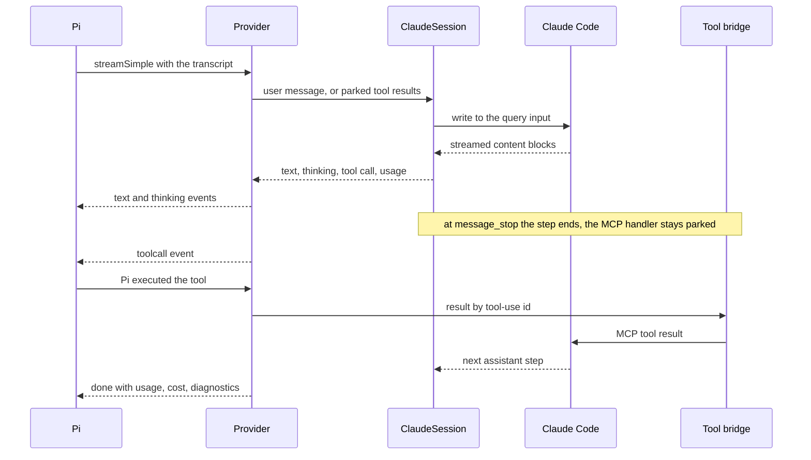

# Architecture

Pi keeps the conversation, the tools, and the approvals. One Claude Code process serves one Pi conversation, driven through the Claude Agent SDK.

| Pi owns | This provider owns | Claude Code owns |
|---|---|---|
| The visible transcript, branches, compaction | Adapter between Pi messages and the Claude session | Its own base prompt and request composition |
| Tool inventory, approvals, and execution | Offered tool schemas and the parking bridge | Delivering MCP tool calls and results |
| Retries and cancellation decisions | Stream conversion, deadlines, process cleanup | Model inference and its internal retries |
| Model selection from the catalog | Catalog discovery and validation | Login and upstream authentication |

## One turn, step by step

A tool call crosses every layer twice: once for the call, once for the result.

Pi's model call ends at `message_stop`, not at the end of the Claude turn. Pi runs the tool, hands the result back, and the next Pi model call continues the same query.

## Session reuse and rebuild

A session is reused only when it still describes what Pi shows the user. All of these must hold:

- A session exists for this Pi session id.
- The native model, the appended prompt, and the offered tool names are unchanged.
- The digest of the messages the session already saw is unchanged.
- What follows that prefix, ignoring Pi's placeholders for aborted steps, is either every parked tool result followed by any user messages, or one or more user messages.

Anything else drops the session and rebuilds it from checkpoint text.

Every rebuild writes the conversation to the prompt cache again; only the system prompt and tools stay cached. On a subscription that cost lands on the plan window, so three common events keep the live session instead:

- A thinking-level change is sent to the live session with `applyFlagSettings({ effortLevel })`. The API still re-caches the whole prompt after an effort change (measured: 0 tokens read, 5,842 written, on the next step), but Claude Code keeps its own record of the conversation instead of a plain-text checkpoint.
- A user message sent while tools run (Pi steering) is appended to the last tool result, as Claude Code does with its own queued input. A separate user message would start a new Claude Code turn that no Pi call reads.
- A cancelled step interrupts the turn but keeps the process. Claude Code ends the turn with an `error_during_execution` result and keeps the conversation, so the next step reads the cached prefix.

An edit, a branch, a resume, or a compaction changes the digest, so the next call rebuilds. The checkpoint is text: earlier turns, the assistant's tool calls, and every completed tool result. A rebuild therefore never re-runs a completed operation and never pretends the new session saw the old one.

A failed call drops the session, because its state after the failure is unknown. Pi's history stays the authority.

## Components

| File | Responsibility |
|---|---|
| `extensions/claude-directsdk/index.ts` | Registers the provider, the API handler, the prompt adjustment, and shutdown cleanup |
| `src/provider.ts` | Catalog state, refresh lifecycle, and the Pi-facing stream factory |
| `src/lazy-stream.ts` | Defers the SDK import until the first request |
| `src/env.ts` | The only reader of the launching environment; guards, child environment |
| `src/sdk/stream.ts` | Session registry, one Pi turn, frame to event conversion |
| `src/sdk/session.ts` | One streaming-input query, frame deadlines, cancellation, close |
| `src/sdk/options.ts` | Isolation options for the child |
| `src/sdk/checkpoint.ts` | Turns Pi history into checkpoint text |
| `src/sdk/tools.ts` | Tool schemas and the MCP server |
| `src/sdk/bridge.ts` | Parks handlers and matches calls to results |
| `src/sdk/adapter.ts` | Shape checks for SDK frames and MCP results |
| `src/sdk/channel.ts` | Bounded queues with deadlines |
| `src/sdk/log.ts` | One JSON line per transport failure, capped and rotated |
| `src/discovery.ts`, `src/web-catalog.ts`, `src/process.ts` | Catalog probes against the CLI picker and Anthropic documents |
| `src/models.ts`, `src/billing.ts`, `src/errors.ts` | Native model ids, usage-credit guard, error types |

### Prompt composition

The child runs Claude Code's `claude_code` preset with Pi's instructions appended. Two adjustments apply:

- Pi's `<docs>` section is replaced with a pointer to Pi's documentation directory, because Anthropic refuses a prompt that lists another agent harness's documentation. The extension does this in `before_agent_start` while a DirectSDK model is active. Other providers keep Pi's prompt, and a custom or forced prompt keeps its own sections. See [Usage](usage.md).
- Sampling controls from Pi options (`temperature`, `top_p`) are not sent, because subscription routes reject them. A thinking level becomes an effort level only when the model's catalog metadata maps it to `low`, `medium`, `high`, `xhigh`, or `max`.

### Isolation

Every session starts with `tools: []`, so Claude Code has no native tool; `settingSources: []` and `strictMcpConfig: true`, so no user, project, or local settings and no `CLAUDE.md` discovery reach it; `skills: []`, `permissionMode: "dontAsk"`, `persistSession: false`; and `autoMemoryEnabled` and `autoDreamEnabled` off.

`allowedTools` lists exactly the offered host tools. Under `dontAsk` Claude Code denies an MCP tool that is not listed, so listing them is what lets a call reach Pi's handler, where Pi decides.

### Environment boundary

`src/env.ts` is the only place that reads the launching environment.

- `checkEnvConflicts` rejects `ANTHROPIC_API_KEY`, `ANTHROPIC_AUTH_TOKEN`, `ANTHROPIC_BASE_URL`, `ANTHROPIC_FOUNDRY_API_KEY`, `CLAUDE_CODE_USE_BEDROCK`, `CLAUDE_CODE_USE_VERTEX`, and `CLAUDE_CODE_USE_FOUNDRY`, because any of them would silently move the request to another billing route. `PI_DIRECTSDK_TEST_UPSTREAM=1` is the documented bypass for loopback fixtures.
- `buildChildEnv` maps `CLAUDE_DIRECTSDK_CONFIG_DIR` to `CLAUDE_CONFIG_DIR`, deletes `ANTHROPIC_BASE_URL` and `CLAUDE_CODE_MAX_RETRIES`, sets `DISABLE_AUTO_COMPACT`, `DISABLE_COMPACT`, and `CLAUDE_CODE_TOTAL_TOKENS_REMINDER=off`, and reports `CLAUDE_CODE_ENTRYPOINT=pi-claude-directsdk`, replacing any inherited label. `CLAUDE_DIRECTSDK_ENTRYPOINT` overrides it; an empty value removes the label and lets the Agent SDK supply `sdk-ts`.

### Session lifecycle

`ClaudeSession` owns one streaming-input `query()`. Pi messages arrive through a bounded input generator; SDK frames arrive through a bounded channel with a deadline per frame. The pump records `system/init` — session id, CLI version, MCP server status — before forwarding frames.

A frame deadline limits one phase, not the whole turn. Cancellation asks the query to interrupt and answers parked tool handlers as not run. The next call waits until the interrupted turn's `result` frame has drained. When the interrupt is not acknowledged, or no `result` arrives within a short grace period, the session closes. Closing settles every parked tool handler, closes both channels, closes the query, and aborts the SDK controller, so no Claude Code process outlives the Pi conversation.

### Tool bridge

Pi tools are exposed as one MCP server named `pi`, so Claude Code sees `mcp__pi__<name>`. The server is a plain MCP `Server` with JSON-Schema definitions; top-level `oneOf`, `allOf`, and `anyOf` are dropped because Claude's validator rejects them, and a nullable `type` array collapses to its non-null member. Tool names are 1 to 50 characters of letters, digits, `_`, or `-`. A tool whose constrained sampling requires strict enforcement is rejected rather than silently unenforced.

A tool never executes in the MCP handler. The handler parks in the bridge and waits for Pi.

Correlation uses `_meta.claudecode/toolUseId`, which Claude Code sends with each call. Without that id the bridge matches the oldest announced call with the same name. A call the bridge cannot attribute fails closed: Pi does not run tools it cannot attribute.

Results are delivered by tool-use id. A result for a call Claude Code announced but has not dispatched is held until the handler arrives, and a duplicate dispatch of the same id is refused instead of executed twice.

### Stream conversion

Claude Code's streamed content blocks are authoritative, because the complete `assistant` message can arrive with or after `message_stop`.

- Text and thinking blocks stream as Pi `text_*` and `thinking_*` events. A thinking block with no readable text and no redaction is dropped from the published message, which is what Claude Code sends for encrypted reasoning.
- The stop reason comes from the `message_delta` event, falling back to the `assistant` message when the delta omits it.
- Tool calls are published from the streamed blocks, with the complete message as the fallback for input that did not stream.
- Usage comes from the assistant message and the delta, never from a sum of steps, so a tool round trip does not double count.
- One `result` frame ends each finished turn. A tool-use step ends at `message_stop`; its `result` arrives only after Pi answers the call.

The provider reads `rate_limit_event.rate_limit_info`. When the response reports usage-credit overage and `CLAUDE_DIRECTSDK_ALLOW_USAGE_CREDITS` is not enabled, the turn fails with a non-retryable `billing` error after usage is captured. Completed and failed turns carry a `pi-claude-directsdk/session` diagnostic with the native model, CLI version, Claude session id, MCP server states, result subtype, and an estimated native cost that is not the subscription charge.

### Failure records

Every failed or cancelled turn is already visible in Pi's session as an assistant message with `stopReason` `error` or `aborted`, its message, and the `pi-claude-directsdk/session` diagnostic. `src/sdk/log.ts` adds a transport-side record, because the CLI's stderr tail and the upstream request id are not part of that diagnostic. It writes one JSON line per failure to `~/.pi/agent/logs/claude-directsdk.jsonl`: timestamp, error kind, message, native model, CLI version, Claude session id, MCP server states, result subtype, Pi session id, request id, and the last stderr text. The file is rotated once at 1 MiB to `.1`, and the previous generation is replaced rather than accumulated. A successful turn writes nothing. `CLAUDE_DIRECTSDK_LOG` moves the file, and an empty value or `off` disables it. Writing is best-effort: a log failure never changes the outcome of a turn, and no credential or prompt text is logged.

### Catalog and startup

DirectSDK registers with an empty catalog and no process, socket, timer, or web request at load. Cache-only refresh restores a previously verified snapshot from Pi's model store; live refresh runs after the editor is ready and loads discovery modules asynchronously. A refresh failure reports the error and deletes the snapshot instead of returning pinned models. See [startup.md](startup.md).

Discovery runs the Claude Code `initialize` handshake through a supervised child behind a loopback guard that denies HTTP and flags attempted Messages requests, so discovery cannot consume subscription allowance. Public Anthropic documents supply model ids, prices, effort levels, and cache lifetimes; the account picker supplies resolved aliases. Missing metadata excludes the affected model with a warning. Verified context windows control native `[1m]` selection, and Claude Code owns thinking mode. No imported table sets a capability, and nothing is replaced with a guessed limit or a zero price.

Catalog children run in their own process group and abort kills the whole tree, which matters on Windows where the npm `claude` shim is `cmd.exe` to `node`. Stdout is read as newline-delimited JSON with an idle deadline that resets on each line. Model calls do not use this path; the SDK owns their process.

## Guarantees

- Pi owns the transcript, the tool inventory, the approvals, and the retries.
- Claude Code runs without its own tools, settings, skills, hooks, or permission decisions.
- The provider never manages login or reads credentials.
- The provider never falls back to another billing route.
- The provider never executes a tool it cannot attribute to a specific tool-use id.
- A turn Claude Code reports as charged to usage credits stops later turns unless the user allows usage credits.
- No Claude Code process outlives the Pi session that started it.
- A missing or logged-out CLI fails with an actionable error. See [troubleshooting.md](troubleshooting.md).
- Only `tool_choice` `auto` and `none` are supported. Grammar and best-effort (`strict: "prefer"`) annotations fall back to normal JSON-schema calling, and required strict (`strict: "require"`) stays rejected.
- A tool call Pi did not offer is never executed and never blocks the turn: Claude Code answers the call itself and the model continues. More than three such calls in one turn fail it. A `system/permission_denied` for an offered tool, or a handshake that reports the Pi tool server as disconnected, fails the turn instead of running without tools.
