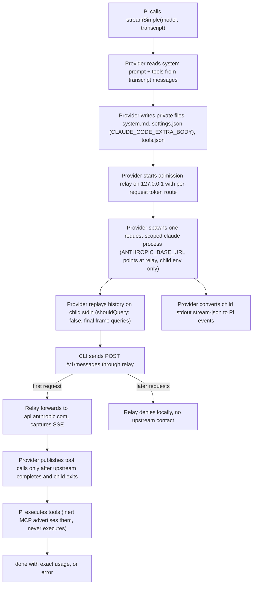

# Architecture

One Pi model call spawns one request-scoped `claude` process and admits at most one upstream Messages request.

## Components

### Provider entry (`src/provider.ts`, `extensions/claude-directsdk/index.ts`)

The extension registers a complete Pi provider with id `claude-directsdk` and an initially empty catalog. Cache-only refresh restores verified snapshots from Pi’s model store without CLI probes or network work. Live refresh runs after editor startup and reports failures instead of returning pinned models.

`streamSimple` uses `src/lazy-stream.ts` to return a stream immediately. The wrapper loads `src/stream.ts` asynchronously and preserves the model, transcript, and request options. See [startup.md](startup.md).

### History replay (`src/replay.ts`)

Pi owns the transcript. Each call replays prior assistant, user, and tool-result frames in native `stream-json` form through a fresh child.

Rules:

- Historical user frames carry `shouldQuery: false` and expect a zero-turn acknowledgment. Only the final frame may generate.
- The last frame must be a nonempty user or tool-result message. Assistant prefill is unsupported.
- Empty text or thinking placeholders from failed and aborted responses are omitted. Nonempty history remains intact.
- Tool-call IDs that Claude cannot accept are mapped to valid native IDs. Tool results use the same mapping. Stored Pi IDs remain unchanged.
- Thinking without a matching native carrier is replayed as ordinary assistant text. This allows switching providers during a session.
- Other unsupported history is rejected with a `replay` error, never flattened into prose.
- Signed native thinking survives only inside a durable carrier (`pi-claude-directsdk/native`) attached to the Pi assistant message. The carrier is restored only when the visible projection (text, thinking, tool calls) still matches. Any edit drops the native blocks. Session files persist the carrier, so resumed turns replay exactly.
- Models with verified mid-conversation tool-change support keep later system messages. The initial system message supplies the system prompt and initial tools. Later tool additions and removals are injected as native system content at their assistant boundaries, and historical calls to any tool declared earlier in the transcript remain replayable. Response validation still uses the current Pi inventory.

### Request assembly (`src/request.ts`)

The system prompt and tool schemas travel through per-request private files with owner-only permissions. Later system messages in the transcript travel through the relay rewrite when the model supports mid-conversation tool changes:

- `system.md`: the system prompt.
- `settings.json`: carries `CLAUDE_CODE_EXTRA_BODY`.
- `tools.json`: the inert MCP manifest.
- `inert-mcp.mjs`: the inert MCP server source.

Files avoid OS argument and environment-string limits. Authentication and identity headers are never replaced. The relay preserves them.

When the model supports mid-conversation tool changes, the request body carries the initial tools, a deferred placeholder, and later-added tools with `defer_loading: true`. The relay adds the `mid-conversation-tool-changes-2026-07-01` beta value to the admitted request and injects native system messages before their assistant boundaries. Unsupported models keep the collapsed system message and current tool set.

The child argv (`buildArgv`) runs the CLI with `--input-format stream-json`, `--output-format stream-json`, `--verbose`, `--include-partial-messages`, `--max-turns 1`, `--permission-mode dontAsk`, `--no-session-persistence`, `--strict-mcp-config`, `--disable-slash-commands`, and an empty `--setting-sources`. `--max-turns 1` is accepted by the qualified CLI even though recent `--help` output hides it. The installed-Pi harness verifies the request path with the user’s real CLI.

The child environment (`buildChildEnv`) points `ANTHROPIC_BASE_URL` at the relay. It sets native isolation flags (`ENABLE_TOOL_SEARCH=false`, `CLAUDE_CODE_DISABLE_NONESSENTIAL_TRAFFIC=1`, `CLAUDE_CODE_MAX_RETRIES=0`, `DISABLE_AUTO_COMPACT=1`, `DISABLE_COMPACT=1`, `CLAUDE_CODE_TOTAL_TOKENS_REMINDER=off`). Sampling controls from Pi options (`temperature`, `top_p`) are dropped because subscription routes reject them.

### Admission relay (`src/admission.ts`)

The relay binds an ephemeral loopback port with a random per-request route (`/admit/<token>`). It forwards only the first upstream Messages request and rejects later native recovery or retry attempts locally with `PI_MODEL_ADMISSION_CONSUMED`. The relay changes HTTP transfer encoding. Request identity stays native. The transport may rewrite the request body for mid-conversation system messages and add beta values to `anthropic-beta`; the payload otherwise stays native.

The relay reconstructs the upstream assistant message from the SSE stream (`SseCapture`) and records status, request id, failure text, and an error body (capped at 64 KiB). Upstream targets must be HTTPS, except loopback HTTP endpoints. Request bodies are capped at 512 MiB.

### Child supervision (`src/process.ts`)

Each Pi model call owns one child in its own process group. Abort and failure kill the full tree. This matters on Windows, where the npm `claude` shim is `cmd.exe` -> `node` and a plain `kill()` would orphan the node child that holds the request open. Stdout is consumed as newline-delimited JSON with an idle deadline that resets on every received line. Each stdin write and child-closure wait also has a deadline, using the request's `timeoutMs`. These are phase limits, not one total runtime limit. Timeout kills the process tree and preserves the first failure. Cancellation rejects pending reads and writes; exit observation remains bounded. Expired read waiters are removed by identity, and every completed operation clears its timer.

The caller receives the child final exit status after its output streams close. Executable tool calls still wait for that exit and the complete upstream response. Discovery cleanup attempts every resource release even if observing child closure fails.

### Native working directory (`src/child-cwd.ts`)

Native model-request children share an empty, persistent directory. Its path remains stable across Pi processes, avoiding a changing native working-directory prefix after restart. Request files, credentials, and transcripts are not stored there.

- Linux: `${XDG_CACHE_HOME:-~/.cache}/pi-claude-directsdk/child`.
- macOS: `~/Library/Caches/pi-claude-directsdk/child`.
- Windows: `%LOCALAPPDATA%/pi-claude-directsdk/child`, with the user's local app-data directory as the fallback.

On POSIX, the provider verifies that its cache root and child directory belong to the current effective user and have mode `0700`. It rejects symlinks and nonempty child directories instead of reading unexpected project instructions or deleting files. Windows uses the access controls inherited from the user's cache parent. Relative cache-directory settings fail with the setting name and a remedy.

The first request after this directory change can miss a previously cached native prefix. A stable path removes this source of cache invalidation; legitimate Pi prompt and tool changes still affect reuse. Linux verification resumed the same session in a new Pi process and measured 99.84% cache-read share with stable Pi prompt and tool hashes. See [transport-measurements.md](transport-measurements.md#linux-lifecycle-and-cross-restart-verification).

### Stream conversion (`src/stream.ts`)

The provider converts child stdout `stream-json` to Pi events. Native result errors are preserved even when stderr is empty. Prompt-length errors report the selected route and configured context window. Native tool calls are published only after the first upstream response is complete and the child has exited. Usage and stop reason come from the authoritative native usage. Incomplete native or upstream responses produce `incomplete` or `upstream` errors.

The provider reads `rate_limit_event.rate_limit_info`. If the authoritative response reports usage-credit overage and `CLAUDE_DIRECTSDK_ALLOW_USAGE_CREDITS` is not enabled, the turn fails with a non-retryable `billing` error after usage is captured. Completed and failed turns carry a `pi-claude-directsdk/rate-limit` diagnostic. Upstream usage-credit rejection text maps to the same error.

### Inert MCP (`src/inert-mcp.ts`)

The MCP server name in the native child is `pi`. Tool names are `mcp__pi__<name>`. The server advertises Pi tools so the CLI can call them. It never executes them. Pi alone executes tools.

The helper uses `process.execPath`. Under Bun, its MCP configuration sets `BUN_BE_BUN=1` only for that helper, so a compiled Pi executable runs the JavaScript rather than starting another agent. Node launches remain unchanged.

### Catalog discovery (`src/discovery.ts`, `src/web-catalog.ts`)

Discovery runs the Claude Code `initialize` handshake through an asynchronous supervised child. It never calls synchronous authentication or version probes. A loopback guard denies all HTTP requests and detects attempted Messages requests; discovery cannot consume subscription allowance.

Cleanup closes the guard's connections, then closes the server only if it is still listening. Bun can stop the server when closing connections; Node leaves it listening. Other cleanup failures remain errors.

Public Anthropic Markdown documents supply current model IDs, model pages, prices, effort levels, and cache lifetimes. Model pages must confirm the canonical Claude API ID, input modalities, context window, output limit, and thinking capability. The account picker supplies resolved aliases and effort constraints. Current public models can appear even before the CLI picker includes them; their labels state that account availability is unverified.

Missing metadata excludes only the affected model with a warning. Shared-source failures reject refresh and remove the snapshot. Refresh uses a shared deadline and abort signal. Pi owns persistence and generation-checked publication.

### Request-time probes (`src/setup.ts`)

CLI resolution and version qualification run only when a model call needs them. They are not part of catalog discovery or editor startup.

## Guarantees

- The provider never executes native tools.
- The provider never manages login or reads credentials.
- The provider never falls back to another billing route.
- A turn that Claude Code reports as charged to usage credits stops later turns unless the user explicitly allows usage credits.
- Missing CLI and logged-out CLI fail with actionable errors. See [troubleshooting.md](troubleshooting.md).

## Model routing

The catalog has no hand-written model inventory, aliases, limits, or price table. Its sources are:

- Claude Code’s account picker for resolved aliases and account-visible models.
- [Anthropic’s model overview](https://platform.claude.com/docs/en/about-claude/models/overview) and linked model pages for canonical routes and capabilities.
- [Anthropic’s pricing documentation](https://platform.claude.com/docs/en/about-claude/pricing) for token prices, request-wide tiers, and cache lifetimes.
- [Anthropic’s effort documentation](https://platform.claude.com/docs/en/build-with-claude/effort) for web-only model effort levels.
- [Anthropic’s mid-conversation documentation](https://platform.claude.com/docs/en/build-with-claude/mid-conversation-system-messages) for the models that accept mid-conversation tool additions and removals.

No imported model table sets a capability. `supportsNativeToolChanges` reads the flag the catalog writes on the model; a model that Anthropic does not list, or a page whose wording the catalog cannot parse, keeps the collapsed request shape and reports a warning instead of a guess.

Verified context windows control native `[1m]` selection. Claude Code owns thinking mode; the request body sends only an effort level that the catalog supports. Missing metadata is never replaced with a guessed limit or a zero price.

`QUALIFIED_CLI_RANGE` in `src/models.ts` still controls transport qualification. Run the installed-Pi harness with fresh and complete-session scenarios before widening it.

## Tool transport

Pi owns tool execution. The native child advertises Pi tools through the inert MCP server and never executes them. The authority is `src/request.ts` (`buildRequestBody`, `normalizeInputSchema`). The stable rules:

- Only `tool_choice` `auto` and `none` are supported.
- Constrained decoding is not enforced. Grammar and best-effort (`strict: "prefer"`) annotations fall back to normal JSON-schema tool calling. Required strict (`strict: "require"`) stays rejected. Malformed native tool input still fails downstream.
- Native tool calls reach Pi only after the first upstream response is complete and the child has exited.
- On models with verified mid-conversation tool-change support, historical calls to tools declared earlier in the transcript are replayable, including tools removed from the current inventory. Pi never executes a tool outside the current inventory.
