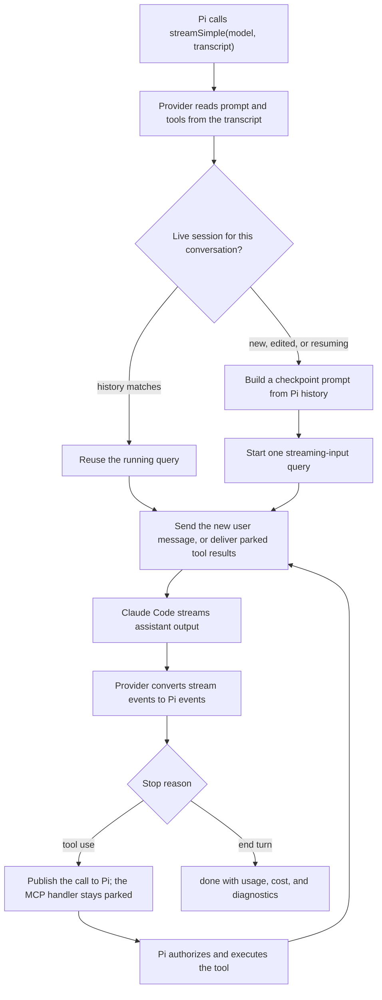

# Architecture

One Claude Code session serves one Pi conversation. Pi keeps the transcript, the tools, and the approvals; the Claude Agent SDK carries the conversation and the model calls.

## Components

### Provider entry (`src/provider.ts`, `extensions/claude-directsdk/index.ts`)

The extension registers a complete Pi provider with id `claude-directsdk` and an initially empty catalog. Cache-only refresh restores verified snapshots from Pi's model store without CLI probes or network work. Live refresh runs after editor startup and reports failures instead of returning pinned models.

The extension also registers the provider's API handler directly, because Pi can dispatch a selected or overridden model while the live catalog is still empty. On shutdown it closes every Claude session it started and unregisters the handler.

`streamSimple` uses `src/lazy-stream.ts` to return a stream immediately. The wrapper loads `src/sdk/stream.ts` on first use, so Pi's startup path never imports the SDK. See [startup.md](startup.md).

### Environment boundary (`src/env.ts`)

This is the only place that reads the launching environment.

- `checkEnvConflicts` rejects `ANTHROPIC_API_KEY`, `ANTHROPIC_AUTH_TOKEN`, `ANTHROPIC_BASE_URL`, `ANTHROPIC_FOUNDRY_API_KEY`, `CLAUDE_CODE_USE_BEDROCK`, `CLAUDE_CODE_USE_VERTEX`, and `CLAUDE_CODE_USE_FOUNDRY`. A conflicting override would silently move the request to another billing route. `PI_DIRECTSDK_TEST_UPSTREAM=1` is the documented bypass for loopback test fixtures.
- `buildChildEnv` forwards `CLAUDE_DIRECTSDK_CONFIG_DIR` as `CLAUDE_CONFIG_DIR`, sets `DISABLE_AUTO_COMPACT`, `DISABLE_COMPACT`, and `CLAUDE_CODE_TOTAL_TOKENS_REMINDER=off`, and deletes `CLAUDE_CODE_ENTRYPOINT` so the SDK supplies its own session label. Pi owns compaction and budgets.

### Session lifecycle (`src/sdk/session.ts`)

`ClaudeSession` owns one streaming-input `query()`. Pi messages arrive through a bounded input generator; SDK messages arrive through a bounded frame channel with a deadline per frame. The pump records `system/init` (session id, CLI version, MCP server status) before forwarding frames.

A frame deadline is a phase limit, not a total runtime limit. Cancellation asks the query to interrupt, waits for a short grace period, then closes. Closing settles every parked tool handler, closes both channels, closes the query, and aborts the SDK's controller, so no Claude Code process outlives the Pi conversation.

### Option isolation (`src/sdk/options.ts`)

Every session starts with:

- `tools: []`, so Claude Code has no native tool to run.
- `settingSources: []` and `strictMcpConfig: true`, so no user, project, or local settings and no `CLAUDE.md` discovery reach the child.
- `skills: []`, `permissionMode: "dontAsk"`, `persistSession: false`.
- `systemPrompt` preset `claude_code` with Pi's instructions appended.
- `autoMemoryEnabled: false` and `autoDreamEnabled: false`.
- `allowedTools` listing exactly the offered host tools. Under `dontAsk`, Claude Code denies an MCP tool that is not listed, so listing them is what lets the call reach Pi's handler, where Pi decides.

Pi's `<docs>` section reaches the child as a short pointer to Pi's documentation directory, not as Pi's list of documentation files. The extension swaps that section in `before_agent_start` while a DirectSDK model is active, because Anthropic refuses a request whose system prompt lists another agent harness's documentation. Other providers keep Pi's prompt, and a custom or forced prompt keeps its own sections. See [Usage](usage.md).

Sampling controls from Pi options (`temperature`, `top_p`) are not sent; subscription routes reject them. A thinking level reaches Claude Code as an effort level only when the model's catalog metadata maps it to one of `low`, `medium`, `high`, `xhigh`, or `max`.

### Session reuse and rebuild (`src/sdk/stream.ts`, `src/sdk/checkpoint.ts`)

Sessions are kept in a registry keyed by Pi's session id. A session is reused only when all of these hold:

- The native model, the effort, the appended prompt, and the offered tool names are unchanged.
- The messages Pi has already shown are byte-identical to what the session saw, compared through a digest of that prefix. An edit anywhere in the prefix, a branch, a resume, or a compaction changes the digest.
- What follows that prefix is either the tool results for the calls Claude Code is waiting on, or exactly one new user message.

Anything else drops the session and starts a new one from a checkpoint. The checkpoint is text: earlier turns, the assistant's tool calls, and every completed tool result. A rebuild therefore never re-runs a completed operation and never pretends the new session saw the old one.

A failed or cancelled call drops the session, because its state after the failure is unknown. Pi's history stays the authority of record.

### Tool bridge (`src/sdk/tools.ts`, `src/sdk/bridge.ts`)

Pi tools are exposed as one MCP server named `pi`, so Claude Code sees `mcp__pi__<name>`. The server is a plain MCP `Server` with JSON-Schema definitions; this transport needs no schema-conversion library. Top-level `oneOf`, `allOf`, and `anyOf` are dropped because Claude's validator rejects them, and nullable `type` arrays collapse to the non-null member. Tool names must be 1 to 50 characters of letters, digits, `_`, or `-`. A tool whose constrained sampling requires strict enforcement is rejected rather than silently unenforced.

A tool call never executes in the MCP handler. The handler parks in the bridge and waits for Pi.

Correlation uses `_meta.claudecode/toolUseId`, which Claude Code sends with each call. Without that id, the bridge matches the oldest announced call with the same tool name. A call the bridge cannot attribute fails closed with an error result: Pi does not run tools it cannot attribute to a specific call.

Results are delivered by tool-use id. A result for a call Claude Code has announced but not yet dispatched is held until the handler arrives. A duplicate dispatch of the same id is refused instead of executed twice.

### Stream conversion (`src/sdk/stream.ts`)

Claude Code's streamed content blocks are authoritative, because the complete `assistant` message can arrive with or after `message_stop`.

- Text and thinking blocks stream as Pi `text_*` and `thinking_*` events. A signature-only thinking block, which is what Claude Code sends for encrypted reasoning, is dropped from the published message.
- The stop reason comes from the `message_delta` stream event. The `assistant` message always reports a null stop reason.
- Tool calls are published from the streamed blocks, with the complete message as the fallback for input that did not stream.
- One `result` frame ends each finished turn. A tool-use step ends at `message_stop`; its `result` arrives only after Pi answers the call.
- Usage comes from the assistant message and the delta, never from a sum of steps, so tool round trips do not double count.

The provider reads `rate_limit_event.rate_limit_info`. If the response reports usage-credit overage and `CLAUDE_DIRECTSDK_ALLOW_USAGE_CREDITS` is not enabled, the turn fails with a non-retryable `billing` error after usage is captured. Completed and failed turns carry a `pi-claude-directsdk/session` diagnostic with the native model, CLI version, Claude session id, MCP server states, result subtype, and an estimated native cost that is not the subscription charge.

### Catalog discovery (`src/discovery.ts`, `src/web-catalog.ts`)

Discovery runs the Claude Code `initialize` handshake through an asynchronous supervised child. It never calls synchronous authentication or version probes. A loopback guard denies all HTTP requests and detects attempted Messages requests; discovery cannot consume subscription allowance.

Cleanup closes the guard's connections, then closes the server only if it is still listening. Bun can stop the server when closing connections; Node leaves it listening. Other cleanup failures remain errors.

Public Anthropic Markdown documents supply current model IDs, model pages, prices, effort levels, and cache lifetimes. Model pages must confirm the canonical Claude API ID, input modalities, context window, output limit, and thinking capability. The account picker supplies resolved aliases and effort constraints. Current public models can appear even before the CLI picker includes them; their labels state that account availability is unverified.

Missing metadata excludes only the affected model with a warning. Shared-source failures reject refresh and remove the snapshot. Refresh uses a shared deadline and abort signal. Pi owns persistence and generation-checked publication.

### Child supervision for discovery (`src/process.ts`)

Catalog discovery still spawns a child. Each discovery child runs in its own process group, and abort or failure kills the full tree. This matters on Windows, where the npm `claude` shim is `cmd.exe` to `node` and a plain `kill()` would orphan the node child. Stdout is consumed as newline-delimited JSON with an idle deadline that resets on every received line. Model calls do not use this path: the SDK owns their process.

## Guarantees

- Pi owns the transcript, the tool inventory, the approvals, and the retries.
- Claude Code runs without its own tools, settings, skills, hooks, or permission decisions.
- The provider never manages login or reads credentials.
- The provider never falls back to another billing route.
- The provider never executes a tool it cannot attribute to a specific tool-use id.
- A turn that Claude Code reports as charged to usage credits stops later turns unless the user explicitly allows usage credits.
- No Claude Code process outlives the Pi session that started it.
- Missing CLI and logged-out CLI fail with actionable errors. See [troubleshooting.md](troubleshooting.md).

## Model routing

The catalog has no hand-written model inventory, aliases, limits, or price table. Its sources are:

- Claude Code's account picker for resolved aliases and account-visible models.
- [Anthropic's model overview](https://platform.claude.com/docs/en/about-claude/models/overview) and linked model pages for canonical routes and capabilities.
- [Anthropic's pricing documentation](https://platform.claude.com/docs/en/about-claude/pricing) for token prices, request-wide tiers, and cache lifetimes.
- [Anthropic's effort documentation](https://platform.claude.com/docs/en/build-with-claude/effort) for web-only model effort levels.

No imported model table sets a capability. Verified context windows control native `[1m]` selection: a model whose verified context window reaches one million tokens is requested with that suffix. Claude Code owns thinking mode. Missing metadata is never replaced with a guessed limit or a zero price.

The installed Claude Code version is not gated by a range. Each session start is the qualification test: the SDK handshake must complete, and Pi reports the CLI's own message when it does not. Run `npm test` and `npm run smoke` before widening any assumption about a new CLI release; see [testing.md](testing.md).

## Tool transport

Pi owns tool execution. The authority is `src/sdk/tools.ts` for the advertised schemas and `src/sdk/bridge.ts` for delivery. The stable rules:

- Only `tool_choice` `auto` and `none` are supported.
- Constrained decoding is not enforced. Grammar and best-effort (`strict: "prefer"`) annotations fall back to normal JSON-schema tool calling. Required strict (`strict: "require"`) stays rejected.
- A tool call for a tool Pi did not offer in that turn fails the turn. Claude Code cannot substitute a native tool.
- A `system/permission_denied` for an offered host tool fails the turn instead of being retried, because it means the call never reached Pi.
- A Pi tool server that the handshake reports as not connected fails the turn instead of running without tools.
